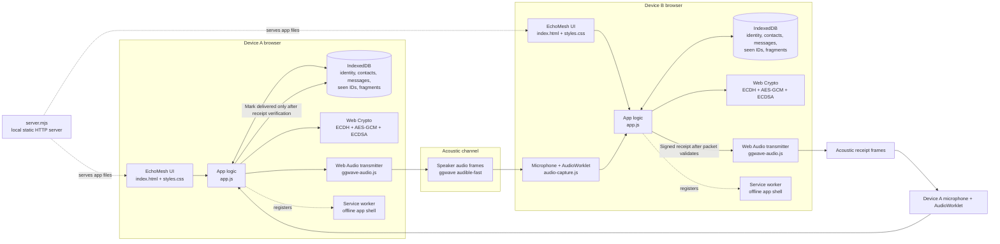

# EchoMesh prototype

## Architecture



Each browser keeps its own identity and data in local IndexedDB. Message content is encrypted and signed before it is split into acoustic frames. The receiving app reassembles and validates a packet before storing it, then can transmit a signed receipt. The sender marks it delivered only after verifying that receipt. The static server serves the app; it does not relay message data between devices.

An offline-first acoustic messaging prototype. This workspace was empty when implementation began; there was no React/Vite app, modem dependency, existing protocol, tests, or design system to extend. The prototype uses browser-native HTML, CSS, JavaScript modules, Web Crypto, IndexedDB, a local Node static server, and ggwave 0.4.0. It makes no network messaging calls. The browser uses the locally bundled ggwave script/WASM and does not fetch a CDN.

## Run

Requires Node.js 20 or newer. In this directory run:

```powershell
npm.cmd start
```

Open `http://localhost:4173`. Localhost is a secure context in supported browsers. For another device, serve through HTTPS; a LAN HTTP address generally does not grant microphone access. The Inbox requests microphone access only after you choose Start listening; a physical device test is still needed.

Install the PWA by visiting the page once while online. The service worker caches the local shell for subsequent offline reloads. There are no essential CDN dependencies. Browser storage can be removed by the browser or user and is not a guaranteed backup.

## Current functionality

- A random 16-character device ID and separate non-extractable P-256 ECDH and ECDSA private keys persist in IndexedDB.
- Public key bundles can be exported and imported. Compare the displayed SHA-256 fingerprint in person or over another trusted channel before accepting a contact. Import confirmation is manual and does not independently verify identity.
- Outgoing text (up to 700 characters) is encrypted with ECDH, HKDF-SHA-256, and AES-256-GCM using a fresh random salt and 96-bit IV per message. Routing metadata is authenticated as GCM additional data; the packet is signed with the sender's ECDSA key. The outgoing record stores ciphertext, not plaintext.
- Incoming packet JSON can be locally validated, signature-checked, and decrypted for the destination. This manual import is a protocol utility, not acoustic reception.
- Packet parsing enforces protocol version, device IDs, packet size, expiration, priority, hop bounds, envelope lengths, duplicate IDs, and authenticated decryption. Hop count is mutable for forwarding; source signature covers the other packet fields.
- Inbox, contacts, sent queue, identity, and deduplication records persist locally.
- A responsive interface and service-worker application-shell cache are included.
- Contact setup has a guided file/paste import dialog and a separate fingerprint review step. The dashboard and Contacts page explain that a contact should be the person on another EchoMesh device.
- Outgoing encrypted packet JSON is split into bounded ≤140-byte text frames, encoded with ggwave's audible-fast protocol, and played through Web Audio. The user explicitly starts playback from Sent messages. Packets above 2,800 bytes are rejected before transmission, preventing ggwave's default 140-byte payload truncation.
- Inbox can request microphone access on user action, capture samples through an AudioWorklet, and pass audio to ggwave decode. The receiver keeps at most eight partial transfers for one hour and caps transfers at 64 frames. Successfully reassembled packets enter the signature, destination, expiry, duplicate, and AES-GCM validation path.
- Playback stays transmitted_unconfirmed until the intended destination sends an explicit signed acoustic receipt. The sender verifies the ECDSA signature, both device IDs, and the message ID before marking it delivered. After an acoustic message is authenticated, the recipient automatically plays its signed receipt. The sender automatically starts listening for it after playback. The recipient can use Send receipt again if a retry is needed. Outgoing message attempts remain limited to three.

## Not implemented / not verified

**Physical speaker-to-microphone transfer is not tested.** The actual ggwave module's browser bundle/WASM loads and an automated in-memory encode/decode test passes. That test does not validate speakers, microphones, room acoustics, browser audio processing, or transfer between devices. Acoustic performance varies by hardware and environment. ggwave documents a low data rate (about 8–16 bytes/second depending on protocol), so a secure packet can take many seconds or minutes to play. No physical-device test has been performed.

automatic retry/backoff, relay queue execution, local AI classification, theme switching, and full accessibility/browser compatibility testing are also not implemented. The hop fields and queue packet format provide a bounded starting point, not a functioning relay network. A Node built-in test checks the bundled modem encode/decode path and maximum fragment size; no TypeScript build exists because no TypeScript/Vite project configuration existed. Browser microphone and speaker hardware have not been tested.

## Security limits

This is a prototype, not a security audit. Static ECDH keys and signatures are protected only as well as the browser profile and device. A removed contact can still have old queued ciphertext. Public key fingerprint comparison is manual. Routing metadata, device IDs, message timing, priority, and packet size are visible. AES-GCM IV collision probability is negligible with fresh random IVs, not mathematically impossible. Local denial of service, malicious browser extensions, storage clearing, compromised devices, and radio/acoustic interference are out of scope. A contact's static ECDH key does not provide forward secrecy. No plaintext should be entered on a relay device.

## Two-device physical test procedure (not yet verified)

1. Open the app on both devices, establish their local identities, and export each public bundle.
2. Exchange bundles and compare fingerprints via a trusted channel before confirming import.
3. Open the app on both devices through HTTPS. Load it once so the service worker caches the app and modem assets; later you can disable internet.
4. On Device B, open Inbox and choose Start listening. Grant microphone permission in the browser prompt. Keep the page open and phone awake.
5. On Device A, compose a short message and queue it. Open Sent messages and choose Transmit by sound. Keep both devices nearby and their volume moderate. A long message can take several minutes because the ggwave modem is low bandwidth.
6. After A finishes playback, it opens Inbox and starts listening automatically. Once B authenticates the complete message, B automatically sends a signed receipt. A marks it Delivered only after verifying that receipt. If a receipt fails, use Send receipt again on B.
7. Repeat with a wrong destination key and altered ciphertext, then reload both apps and verify local persistence. A wrong key should fail destination authentication.

The software modem and audio paths are implemented, but complete this physical test before relying on the acoustic path. Relay forwarding still needs implementation.
